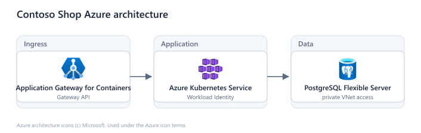
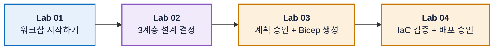
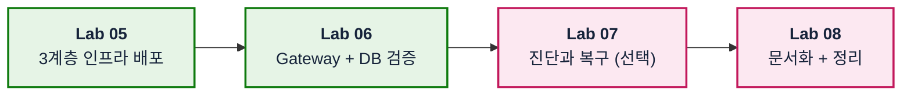

# Azure Skills 기반 Azure 인프라 배포 워크샵

## 🔥 오늘, 당신은 Contoso의 플랫폼 엔지니어입니다

**D-7.** 커머스팀의 신규 서비스 출시가 일주일 앞입니다. 인터넷 진입점, Kubernetes, Database가 필요합니다.

> 🗣️ **"실제 서비스와 비슷한 Azure 환경을 준비해 주세요."**
>
> 1. **클릭으로 만들지 마세요.** `설계 → 승인 → 코드 → 검증 → 배포` 순서로.
> 2. **왜 그렇게 만들었는지 남기세요.** 다음 사람이 이어받을 수 있게.
> 3. **동작한다는 걸 증명하세요.** 실제로 트래픽을 처리하는 화면으로.

CLI 명령을 외우는 대신 **Azure Skills**를 사용합니다.

- Skill은 대안·위험·비용을 정리해 제안합니다
- 참가자는 제안을 검토하고 승인합니다
- 마지막으로 조회 결과로 실제 상태를 확인합니다

## 🏁 배포할 아키텍처



- **Application Gateway for Containers**: Gateway API 기반 Public Ingress
- **Azure Kubernetes Service**: System/User Node Pool과 Cilium Network Policy
- **PostgreSQL Flexible Server**: Private Subnet과 Microsoft Entra 인증
- **Workload Identity**: Password 없이 Azure Kubernetes Service에서 PostgreSQL 연결

## 🖥️ 확인할 화면


커머스팀이 출시할 **Contoso Shop**입니다. 화면 아래에는 현재 트래픽을 처리하는 Pod 이름이 표시되며, Pod를 다시 만들면 함께 바뀝니다.

앱 이미지는 빌드하지 않습니다.

- 공개 NGINX 이미지에 **ConfigMap**으로 화면을 주입합니다
- **Downward API**로 Pod 정보를 전달합니다
- 앱 코딩 없이 Manifest만으로 만듭니다

## 🗺️ 오늘의 여정

**1부 · 설계와 검증**



**2부 · 실행과 마무리**



앞 Lab의 결과물이 다음 Lab의 입력입니다. Lab은 순서대로 진행합니다.

| Lab | 주 Skill | 다음 Lab에 넘길 것 |
| --- | --- | --- |
| [01. 워크샵 시작하기](docs/labs/01-orientation-and-setup.md) | `azure-resource-lookup` | `.env`, 확인된 Scope |
| [02. 3계층 설계 결정하기](docs/labs/02-design-aks.md) | `azure-quotas`, `azure-kubernetes`, `azure-postgres` | Quota, Network, SKU 결정 |
| [03. 계획 승인 + Bicep 생성](docs/labs/03-plan-and-bicep.md) | `azure-enterprise-infra-planner` | 승인된 계획, Bicep |
| [04. IaC 검증 + 배포 승인](docs/labs/04-validate-and-approve.md) | `azure-enterprise-infra-planner` | 검증 증거, 배포 승인 |
| [05. 3계층 인프라 배포](docs/labs/05-deploy-and-connect.md) | `azure-enterprise-infra-planner` | AGC Add-on, Azure Kubernetes Service, PostgreSQL |
| [06. Gateway + DB 검증](docs/labs/06-run-sample-workload.md) | `kubectl` | Public URL, PostgreSQL Query |
| [07. 진단과 복구 (선택)](docs/labs/07-diagnose-and-recover.md) | `azure-diagnostics` | 원인·복구 기록 |
| [08. 문서화 + 정리](docs/labs/08-document-and-cleanup.md) | `azure-resource-visualizer` | 인계 문서, 삭제 증거 |

## 🚀 시작하기

혼자서 끝까지 진행할 수 있게 만들어졌습니다. 사전 세팅을 받지 않아도 됩니다.

### 1. Azure 권한을 확인합니다

다음 두 가지를 **본인이 직접** 할 수 있어야 합니다. 하나라도 안 되면 끝까지 진행할 수 없습니다.

- Resource Group에 Azure Kubernetes Service, Application Gateway for Containers, PostgreSQL을 배포할 권한
- 실습이 끝난 뒤 리소스를 **삭제**할 권한

> [!WARNING]
> **실제 비용이 발생하는 리소스**를 만듭니다.
>
> - Azure Kubernetes Service Node는 실행되는 동안 계속 과금됩니다
> - 중간에 멈춰도 [Lab 08](docs/labs/08-document-and-cleanup.md)의 정리 단계는 진행합니다
> - 회사 공용 Subscription에서는 **전용 Resource Group**을 만들어 사용합니다

### 2. Codespace를 엽니다

[](https://codespaces.new/wonsungso/azure-infra-skills-workshop)

Azure CLI, Bicep, `kubectl`, `kubelogin`과 Azure Skill 7개가 준비됩니다.

컨테이너 준비가 끝나면 도구 상태를 확인합니다.

> 💻 **터미널에서 실행**

```bash
az version && az bicep version && kubectl version --client && kubelogin --version
ls .github/skills
```

Azure 로그인과 Skill 동작 확인은 [Lab 01](docs/labs/01-orientation-and-setup.md)에서 합니다.

로컬 VS Code로도 진행할 수 있습니다.

- 위 도구를 직접 설치합니다
- [`init-workshop.sh`](scripts/init-workshop.sh)를 한 번 실행합니다
- 이후 Lab은 Codespace와 동일합니다

### 3. Lab 01부터 순서대로 진행합니다

[Lab 01: 워크샵 시작하기](docs/labs/01-orientation-and-setup.md)에서 시작합니다.

<details>
<summary>진행이 중간에 끊겼다면</summary>

새 세션에서 아래 프롬프트로 현재 상태부터 이어갑니다.

> 💬 **Copilot 채팅에 붙여넣기**

```text
이 저장소의 .env와 infra-report.md를 읽고 현재 완료된 단계를 판별해줘. Azure에서 실제 상태를 조회해 문서와 비교하되 리소스를 변경하지 마. 다음 미완료 단계와 선행 조건만 제시해줘.
```

</details>

## 💻 Skill과 도구

| Skill / 도구 | 역할 |
| --- | --- |
| `azure-resource-lookup` | 실제 자원을 읽기 전용으로 조회 |
| `azure-quotas` | vCPU Quota와 Region 용량 확인 |
| `azure-kubernetes` | Azure Kubernetes Service Day-0 설계 검토 |
| `azure-postgres` | PostgreSQL Network·인증 검토 |
| `azure-enterprise-infra-planner` | Least Privilege 매트릭스 설계, 계획 승인, Bicep 생성·검증·배포 |
| `azure-diagnostics` | 증거 기반 오류 진단 |
| `azure-resource-visualizer` | 리소스 관계를 다이어그램으로 정리 |
| MCP 도구 / CLI / `kubectl` | 제안을 실제로 실행 |

Skill은 판단과 절차를, 도구는 실행을 담당합니다.

- 프롬프트에 Skill 이름을 썼다는 사실만으로는 증거가 되지 않습니다
- 검토 결과는 [`add-report.sh`](scripts/add-report.sh)가 `infra-report.md`에 문서로 기록합니다

## ⚡ Skill을 쓰면 무엇이 달라지나

같은 인프라 작업을 세 가지 방식으로 할 수 있습니다.

| 방식 | 해주는 것 | 빠지는 것 |
| --- | --- | --- |
| 🖐 **수동** (포털·CLI) | 내가 모든 것을 결정하고 입력 | 결정 근거가 남지 않음. 문서화는 전부 별도 작업 |
| 💬 **일반 프롬프트** | 그럴듯한 명령어와 템플릿을 빠르게 생성 | **내 Subscription의 실제 상태를 모름.** 승인 단계가 없고, 검증 없이 "됐다"고 답하기 쉬움 |
| ⚡ **Skill** | 절차·가드레일·검증 순서를 함께 제공 | 판단과 승인은 여전히 사람 몫 |

핵심 차이는 **속도가 아니라 절차**입니다.

- 일반 프롬프트도 Bicep을 빠르게 만들 수 있습니다
- 하지만 `quota 확인 → 계획 승인 → 배포 전 검증` 순서는 보장하지 않습니다
- 문제는 대개 이 순서를 건너뛸 때 생깁니다

각 Lab에는 **"💡 Skill을 안 썼다면?"** 비교가 접혀 있습니다. 해당 단계를 마친 뒤 비교해 볼 수 있습니다.

## 📂 자료 구분

| 위치 | 내용 |
| --- | --- |
| `docs/labs/` | Lab 01~08 가이드. 프롬프트와 입력값이 모두 이 안에 있습니다 |
| `reference/infra/` | Bicep 기준본 - **정답지가 아니라 비교용** |
| `reference/kubernetes/` | 웹·Gateway API·PostgreSQL 검증 Manifest |
| `templates/` | [인계 문서 양식](templates/handoff-template.md) - Lab 08에서 채웁니다 |
| `.devcontainer/` | Codespace 환경 정의 |
| `scripts/` | `.env` 초기화([`init-workshop`](scripts/init-workshop.sh)), 값 반영([`set-env`](scripts/set-env.sh)), 보고서 작성([`add-report`](scripts/add-report.sh)) |

모든 Lab은 같은 순서를 따릅니다. 목표 → 왜 필요한가 → 시작 전에 → Step → 완료 체크리스트 → 문제가 생겼다면 → 다음 Lab.

## 🛡️ 안전 경계

- 배포·역할 변경·장애 주입·삭제는 **대상과 영향을 확인한 뒤 승인**하고 수행합니다.
- 실행 결과가 없는 내용은 `예상` 또는 `미검증`으로 표기합니다.
- Authorized IP Ranges에 `0.0.0.0/0`을 넣지 않습니다. 접속이 안 되면 내 Egress IP부터 다시 확인합니다.
- 샘플은 `lab` Namespace에서만 실행합니다. 외부 진입점은 Application Gateway for Containers만 사용합니다.
- Subscription ID, Tenant ID, Kubeconfig 내용은 저장소에 기록하지 않습니다([AGENTS.md](AGENTS.md) 참고).

---

## 준비되셨나요?

### ➡️ [Lab 01: 워크샵 시작하기](docs/labs/01-orientation-and-setup.md)

앞 Lab의 결과물이 다음 Lab의 입력입니다. Lab은 순서대로 진행합니다.
