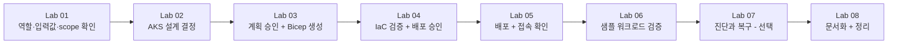

# Azure Skills 기반 AKS 워크샵

## 🔥 Azure Skills로 AKS 인프라를 설계부터 정리까지 직접 운영하기

여러분은 사내 플랫폼팀에 새로 합류한 엔지니어입니다. 오늘 임무는 팀 전용 AKS(Azure Kubernetes Service) 환경을 하나 만들어, 간단한 샘플 서비스를 올리고, 실제 구성을 문서로 남긴 뒤 깔끔하게 정리하는 것입니다. 다만 이 모든 과정을 CLI 명령어를 외워서 하는 대신, **Azure Skill에게 요청하고 → 제안을 검토하고 → 승인하고 → 실제 결과를 확인**하는 방식으로 진행합니다.

이 워크샵의 진짜 목표는 AKS 자체를 마스터하는 것이 아니라, **Azure Skills를 활용해 인프라 작업을 안전하고 반복 가능하게 수행하는 감각**을 익히는 것입니다. AKS는 그 감각을 연습하기 위한 하나의 시나리오일 뿐입니다.

모든 Lab은 겉보기엔 서로 다른 작업처럼 보이지만, 실제로는 **하나의 팀 전용 AKS 환경**을 처음부터 끝까지 이어서 운영하는 과정입니다. 앞 Lab의 결과물이 다음 Lab의 입력이 되므로, 순서를 건너뛰지 않고 위에서 아래로 따라가면 됩니다.

## 🧠 이 워크샵을 마치면 할 수 있는 것

- Azure Skill에게 인프라 요구사항을 설명하고, 대안·위험·비용을 비교한 제안을 받습니다
- "계획 승인 → 코드 생성 → 검증 → 배포 승인 → 배포"라는 안전한 순서를 실제로 경험합니다
- AKS의 네트워크·노드풀·접근 제어를 만들기 전에 결정해야 하는 이유를 이해합니다
- Azure 관리 권한과 Kubernetes 내부 권한이 서로 다른 시스템이라는 것을 구분합니다
- 배포와 워크로드 상태를 "그럴듯한 응답"이 아니라 실제 조회 결과로 검증합니다
- Azure 리소스 관계와 Kubernetes 리소스 관계를 분리해서 정확히 문서화합니다
- 안전하게 정리(삭제 또는 잔여 자원 확인)하고 결과를 인계합니다

## 💻 이 워크샵에서 사용하는 Skill과 도구

| Skill / 도구 | 역할 | 주로 사용하는 Lab |
| --- | --- | --- |
| `azure-resource-lookup` | 실제 Azure 자원을 읽기 전용으로 조회 | 01, 05, 08 |
| `azure-kubernetes` | AKS Day-0 설계(네트워크/노드풀/접근) 검토 | 02 |
| `azure-rbac` | 최소 권한 매트릭스 설계 | 02 |
| `azure-enterprise-infra-planner` | 계획 수립·승인, Bicep 생성·검증·배포 | 03, 04, 05 |
| `azure-diagnostics` | 실제 증거 기반 오류 진단 | 07 (선택) |
| `azure-resource-visualizer` | 실제 리소스 관계를 Mermaid 문서로 정리 | 08 |
| MCP 도구 / CLI / `kubectl` | Skill의 제안을 실제로 실행 | 전 과정 |

Skill은 판단·절차·가드레일을 제공하고, MCP 도구와 CLI가 실제 작업을 수행합니다. **프롬프트에 Skill 이름을 썼다는 사실만으로는 실행 증거가 되지 않습니다.** 응답에 어떤 Skill 지침을 참조했는지, 어떤 도구를 실제로 호출했는지를 [증거 로그](templates/evidence-log.md)에 남기세요.

## 🚀 시작하기

1. [설계 결정](docs/00-design-decisions.md)을 읽고 확정 사항과 리허설 항목을 구분합니다.
2. [사전 준비](docs/01-prerequisites.md)를 완료하고 강사에게 실습 범위를 배정받습니다.
3. [공통 입력표](templates/team-inputs.md)를 열어둡니다 (실제로 채우는 것은 Lab 01에서 합니다).
4. [Lab 01](docs/labs/01-orientation-and-setup.md)부터 번호 순서대로 진행합니다.

## 🗺️ 실습 흐름 (총 6시간)

| Lab | 시간 | 주 Skill | 다음 Lab으로 전달할 산출물 |
| --- | --- | --- | --- |
| [01. 워크샵 시작하기](docs/labs/01-orientation-and-setup.md) | 30분 | `azure-resource-lookup` | 완성된 입력표, 확인된 scope |
| [02. AKS 설계 결정하기](docs/labs/02-design-aks.md) | 45분 | `azure-kubernetes`, `azure-rbac` | Day-0 결정표, 최소 권한 매트릭스 |
| [03. 계획 승인 + Bicep 생성](docs/labs/03-plan-and-bicep.md) | 55분 | `azure-enterprise-infra-planner` | 승인된 인프라 계획, 생성된 Bicep |
| ☕ 휴식 | 10분 | - | - |
| [04. IaC 검증 + 배포 승인](docs/labs/04-validate-and-approve.md) | 45분 | `azure-enterprise-infra-planner` | 검증 증거, 명시적 배포 승인 |
| [05. 배포 + 접속 확인](docs/labs/05-deploy-and-connect.md) | 45분 | `azure-enterprise-infra-planner`, `azure-resource-lookup` | Ready 상태, 최소 권한 확인 결과 |
| ☕ 휴식 | 10분 | - | - |
| [06. 샘플 워크로드 검증](docs/labs/06-run-sample-workload.md) | 40분 | 도구 실행 | Deployment/Pod/Service 정상 증거 |
| [07. 진단과 복구 (선택)](docs/labs/07-diagnose-and-recover.md) | 30분 | `azure-diagnostics` | 원인·복구·재검증 기록 |
| [08. 문서화 + 정리](docs/labs/08-document-and-cleanup.md) | 50분 | `azure-resource-lookup`, `azure-resource-visualizer` | 인계 문서, 삭제 또는 잔여 자원 증거 |

시간이 부족하면 Lab 07(진단과 복구)을 생략하고 Lab 08의 문서화·정리 시간을 확보하세요. Lab 07은 선택이지만 Lab 01~06과 Lab 08은 순서대로 모두 진행해야 합니다.

## 📋 각 Lab은 이렇게 구성되어 있습니다

모든 Lab 문서는 같은 형식을 따르므로, 한 번 익숙해지면 나머지 Lab도 바로 따라갈 수 있습니다.

1. **⏱ 예상 시간 / 🎯 배우는 것**: 이 Lab에서 얻는 것을 미리 알려줍니다.
2. **왜 이 랩이 필요한가요?**: 초심자도 이해할 수 있도록 배경을 설명합니다.
3. **시작 전에 확인하세요**: 직전 Lab에서 준비해야 할 것입니다.
4. **Step 1, 2, ...**: 복사해서 바로 쓸 수 있는 프롬프트와, 사람이 직접 판단해야 할 지점을 순서대로 안내합니다.
5. **✅ 완료 체크리스트**: 다음 Lab으로 넘어가기 전 스스로 점검하는 목록입니다.
6. **🚧 문제가 생겼다면**: 자주 발생하는 증상과 대응 방법을 표로 정리했습니다.
7. **다음 Lab**: 다음에 사용할 산출물과 이동할 링크입니다.

진행이 끊기면 [재개 프롬프트](prompts/workshop-prompts.md#재개)를 사용하세요. 먼저 입력표, [체크포인트](templates/checkpoint.md), 증거 로그와 실제 Azure 상태를 읽기 전용으로 비교하고, 이미 완료된 작업은 다시 실행하지 않습니다.

## 📂 자료 구분

- `docs/labs/`: 참가자가 위에서 아래로 따라가는 Skills 중심 가이드 (Lab 01~08)
- `prompts/`: 복사 가능한 프롬프트와 재개 프롬프트
- `instructor/`: 권한, 시간 운영, 장애 대응, 정리 책임 (강사용)
- `reference/`: 강사용 Bicep 기준본과 Kubernetes manifest (복구·비교 용도)
- `templates/`: 입력값, 체크포인트, 증거, 최종 인계 양식

`reference/`는 참가자 본문의 주 경로가 아닙니다. 참가자는 먼저 Skill에 작업을 요청하고 결과를 검토하며, 기준본은 복구와 리허설에만 사용합니다.

## 👩‍🏫 사전 준비와 역할

참가자는 Azure 구독 또는 리소스 그룹, 리전, 공인 출구 IP, 이름 규칙을 [입력표](templates/team-inputs.md)에 기록합니다(Lab 01에서 진행). 강사는 quota와 용량을 확인하고, foundation 자원, Entra, Kubernetes namespace 및 최소 권한을 bootstrap합니다. 상세 책임은 [강사 가이드](instructor/instructor-guide.md)에 있습니다.

참가자가 직접 수행하지 않는 작업도 각 Lab에 명시되어 있습니다. 예를 들어 namespace 생성과 권한 부여는 강사 bootstrap이며, 참가자는 실제로 허용된 권한만 검증합니다.

## 🛡️ 안전 경계

실제 Azure 배포, 역할 변경, 장애 주입, 리소스 삭제는 모두 대상과 영향을 확인한 별도 승인 후에만 수행합니다. 실행 결과가 없는 문서는 `예상` 또는 `미검증`으로 표기합니다. `azure-validate`와 `azure-deploy`의 상태 파일을 수동 생성하거나 수정해 플래너 흐름에 연결하지 않습니다.

공개 AKS API는 행사장과 실행 클라이언트의 허용 IP 목록으로 제한합니다. 접속 오류를 해결하려고 `0.0.0.0/0`을 추가하거나 허용 목록을 비우지 않습니다. 샘플은 `lab` namespace에서만 실행하며 외부 LoadBalancer나 Ingress를 만들지 않습니다.