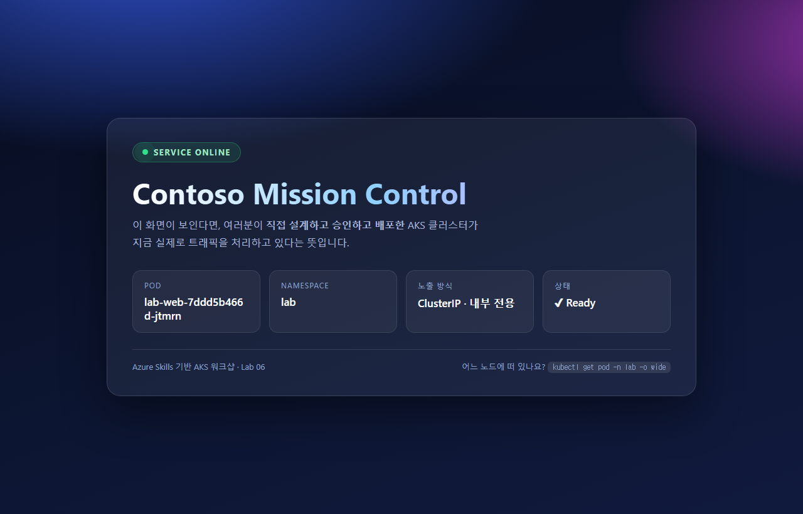
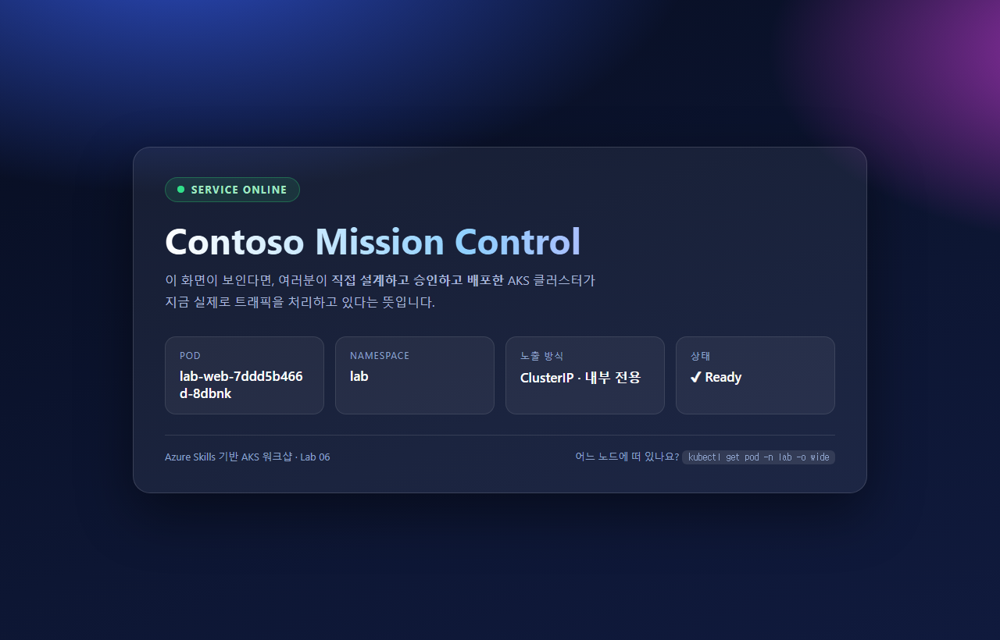
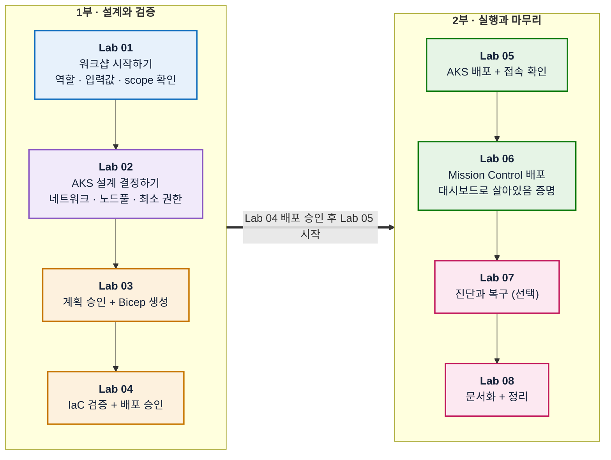

# Azure Skills 기반 AKS 워크샵

## 🔥 오늘, 당신은 Contoso의 플랫폼 엔지니어입니다

**📅 D-7 — 커머스팀의 신규 서비스 출시가 일주일 앞으로 다가왔습니다.**

그런데 개발팀이 코드를 올릴 **Kubernetes 환경이 아직 없습니다.** 오늘 아침, 팀장이 당신에게 첫 임무를 건넵니다.

> 🗣️ **"팀 전용 AKS 환경을 오늘 안에 준비해 주세요. 조건은 세 가지입니다."**
>
> 1️⃣ **콘솔에서 클릭으로 만들지 마세요.** 우리 팀은 `설계 → 승인 → 코드 → 검증 → 배포` 순서로 일합니다.
> 2️⃣ **왜 그렇게 만들었는지 남기세요.** 다음 사람이 당신 없이도 운영할 수 있어야 합니다.
> 3️⃣ **살아있다는 걸 증명하세요.** "만들었습니다"가 아니라, 실제로 트래픽을 처리하는 화면을 보여주세요.

당신의 무기는 CLI 명령어 암기가 아니라 **Azure Skills**입니다. Skill에게 요구사항을 설명하면 대안·위험·비용을 비교한 제안이 돌아옵니다. 당신이 할 일은 그 제안을 **검토하고, 승인하고, 결과를 실제 조회로 검증하는 것**입니다.

이 워크샵의 진짜 목표는 AKS 자체를 마스터하는 것이 아니라, **Azure Skills로 인프라 작업을 안전하고 반복 가능하게 수행하는 감각**을 익히는 것입니다. AKS는 그 감각을 연습하기 위한 무대입니다.

### 🏁 6시간 뒤, 여러분의 클러스터에서 이 화면이 떠 있어야 합니다

여러분이 마지막에 배포할 **Contoso Mission Control** 대시보드입니다. `POD` 카드에 보이는 이름은 고정된 텍스트가 아니라, **여러분의 클러스터에서 지금 응답하고 있는 실제 Pod의 이름**입니다.

Pod를 지우면 이름이 바뀝니다. 아래는 같은 화면을 Pod 재생성 뒤에 다시 찍은 것입니다.

> [!NOTE]
> 이 대시보드는 **컨테이너 이미지를 빌드하지 않습니다.** 공개 nginx 이미지에 ConfigMap으로 화면을 주입하고, Kubernetes **Downward API**로 Pod 정보를 실시간으로 전달합니다. 즉, 앱 코딩 없이 순수하게 **매니페스트만으로** 만드는 결과물입니다.

### 🗺️ 오늘의 여정

모든 Lab은 겉보기엔 서로 다른 작업처럼 보이지만, 실제로는 **하나의 팀 전용 AKS 환경**을 처음부터 끝까지 이어서 만들어가는 과정입니다. 앞 Lab의 결과물이 다음 Lab의 입력이 되므로, 순서를 건너뛰지 않고 위에서 아래로 따라가면 됩니다.

| | 여러분이 만드는 것 | 팀장이 요구한 조건 |
| --- | --- | --- |
| **Lab 01–04** | 설계 문서와 검증된 Bicep 코드 | 1️⃣ 클릭이 아니라 승인 기반으로 |
| **Lab 05–06** | 살아있는 AKS와 Mission Control 대시보드 | 3️⃣ 살아있다는 걸 증명 |
| **Lab 07–08** | 장애 대응 기록과 인계 문서 | 2️⃣ 다음 사람이 이어받을 수 있게 |

## 🧠 이 워크샵을 마치면 할 수 있는 것

- Azure Skill에게 인프라 요구사항을 설명하고, 대안·위험·비용을 비교한 제안을 받습니다
- "계획 승인 → 코드 생성 → 검증 → 배포 승인 → 배포"라는 안전한 순서를 실제로 경험합니다
- AKS의 네트워크·노드풀·접근 제어를 만들기 전에 결정해야 하는 이유를 이해합니다
- Azure 관리 권한과 Kubernetes 내부 권한이 서로 다른 시스템이라는 것을 구분합니다
- 배포와 워크로드 상태를 "그럴듯한 응답"이 아니라 실제 조회 결과로 검증합니다
- Azure 리소스 관계와 Kubernetes 리소스 관계를 분리해서 정확히 문서화합니다
- 안전하게 정리(삭제 또는 잔여 자원 확인)하고 결과를 인계합니다

## 💻 이 워크샵에서 사용하는 Skill과 도구

| Skill / 도구 | 역할 | 주로 사용하는 Lab |
| --- | --- | --- |
| `azure-resource-lookup` | 실제 Azure 자원을 읽기 전용으로 조회 | 01, 05, 08 |
| `azure-kubernetes` | AKS Day-0 설계(네트워크/노드풀/접근) 검토 | 02 |
| `azure-rbac` | 최소 권한 매트릭스 설계 | 02 |
| `azure-enterprise-infra-planner` | 계획 수립·승인, Bicep 생성·검증·배포 | 03, 04, 05 |
| `azure-diagnostics` | 실제 증거 기반 오류 진단 | 07 (선택) |
| `azure-resource-visualizer` | 실제 리소스 관계를 Mermaid 문서로 정리 | 08 |
| MCP 도구 / CLI / `kubectl` | Skill의 제안을 실제로 실행 | 전 과정 |

Skill은 판단·절차·가드레일을 제공하고, MCP 도구와 CLI가 실제 작업을 수행합니다. **프롬프트에 Skill 이름을 썼다는 사실만으로는 실행 증거가 되지 않습니다.** 응답에 어떤 Skill 지침을 참조했는지, 어떤 도구를 실제로 호출했는지를 [증거 로그](templates/evidence-log.md)에 남기세요.

## 🚀 시작하기

이 워크샵은 **혼자서 처음부터 끝까지 진행할 수 있도록** 만들어졌습니다. 별도의 사전 세팅을 받지 않아도 됩니다.

1. [사전 준비](docs/01-prerequisites.md)를 따라 도구와 Azure 권한을 준비합니다.
2. [설계 결정](docs/00-design-decisions.md)을 훑어보며 "이미 정해진 것"과 "내가 결정할 것"을 구분합니다.
3. [입력표](templates/team-inputs.md)를 열어둡니다 (실제로 채우는 것은 Lab 01에서 합니다).
4. [Lab 01](docs/labs/01-orientation-and-setup.md)부터 번호 순서대로 진행합니다.

> [!IMPORTANT]
> 이 워크샵은 **실제 비용이 발생하는 Azure 리소스**를 생성합니다. 반드시 본인이 삭제 권한을 가진 구독·리소스 그룹에서 진행하고, [Lab 08](docs/labs/08-document-and-cleanup.md)의 정리 단계까지 끝내세요.

여러 명이 함께 진행한다면 **각자 별도의 리소스 그룹과 서로 겹치지 않는 CIDR**을 사용하세요. 클러스터 이름은 Bicep이 자동으로 고유 접미사를 붙이므로 겹치지 않아도 됩니다.

## 🗺️ 실습 흐름 (총 6시간)

| Lab | 시간 | 주 Skill | 다음 Lab으로 전달할 산출물 |
| --- | --- | --- | --- |
| [01. 워크샵 시작하기](docs/labs/01-orientation-and-setup.md) | 30분 | `azure-resource-lookup` | 완성된 입력표, 확인된 scope |
| [02. AKS 설계 결정하기](docs/labs/02-design-aks.md) | 45분 | `azure-kubernetes`, `azure-rbac` | Day-0 결정표, 최소 권한 매트릭스 |
| [03. 계획 승인 + Bicep 생성](docs/labs/03-plan-and-bicep.md) | 55분 | `azure-enterprise-infra-planner` | 승인된 인프라 계획, 생성된 Bicep |
| ☕ 휴식 | 10분 | - | - |
| [04. IaC 검증 + 배포 승인](docs/labs/04-validate-and-approve.md) | 45분 | `azure-enterprise-infra-planner` | 검증 증거, 명시적 배포 승인 |
| [05. 배포 + 접속 확인](docs/labs/05-deploy-and-connect.md) | 45분 | `azure-enterprise-infra-planner`, `azure-resource-lookup` | Ready 상태, 최소 권한 확인 결과 |
| ☕ 휴식 | 10분 | - | - |
| [06. Mission Control 대시보드 배포](docs/labs/06-run-sample-workload.md) | 40분 | 도구 실행 | 동작하는 대시보드, 계층별 정상 증거 |
| [07. 진단과 복구 (선택)](docs/labs/07-diagnose-and-recover.md) | 30분 | `azure-diagnostics` | 원인·복구·재검증 기록 |
| [08. 문서화 + 정리](docs/labs/08-document-and-cleanup.md) | 50분 | `azure-resource-lookup`, `azure-resource-visualizer` | 인계 문서, 삭제 또는 잔여 자원 증거 |

시간이 부족하면 Lab 07(진단과 복구)을 생략하고 Lab 08의 문서화·정리 시간을 확보하세요. Lab 07은 선택이지만 Lab 01~06과 Lab 08은 순서대로 모두 진행해야 합니다.

### 🏆 배지 수집판

각 Lab을 완료할 때마다 배지를 하나씩 획득합니다. 여덟 개를 모두 채우면 미션 완료입니다.

| | 배지 | 획득 조건 |
| --- | --- | --- |
| ⬜ | 🧭 **환경 탐색가** | 배정된 Azure 범위를 읽기 전용으로 확인함 |
| ⬜ | 📐 **설계자** | 네트워크·노드풀·권한 결정을 근거와 함께 기록함 |
| ⬜ | 📝 **계획 승인자** | 계획을 승인받은 뒤에 Bicep을 생성함 |
| ⬜ | 🔍 **검증 통과자** | 배포 전에 코드가 설계와 일치함을 증명함 |
| ⬜ | 🚀 **배포 엔지니어** | 실제 AKS 클러스터를 띄우고 접속을 확인함 |
| ⬜ | 📦 **워크로드 운영자** | Mission Control 대시보드를 띄우고 계층별로 검증함 |
| ⬜ | 🔧 **트러블슈터** | 추측이 아니라 근거로 원인을 찾고 복구를 재검증함 |
| ⬜ | 📚 **인계 완료자** | 실제 구성을 문서화하고 안전하게 정리함 |

## 📋 각 Lab은 이렇게 구성되어 있습니다

모든 Lab 문서는 같은 형식을 따르므로, 한 번 익숙해지면 나머지 Lab도 바로 따라갈 수 있습니다.

1. **⏱ 예상 시간 / 🎯 배우는 것**: 이 Lab에서 얻는 것을 미리 알려줍니다.
2. **왜 이 랩이 필요한가요?**: 초심자도 이해할 수 있도록 배경을 설명합니다.
3. **시작 전에 확인하세요**: 직전 Lab에서 준비해야 할 것입니다.
4. **Step 1, 2, ...**: 복사해서 바로 쓸 수 있는 프롬프트와, 사람이 직접 판단해야 할 지점을 순서대로 안내합니다.
5. **✅ 완료 체크리스트**: 다음 Lab으로 넘어가기 전 스스로 점검하는 목록입니다.
6. **🚧 문제가 생겼다면**: 자주 발생하는 증상과 대응 방법을 표로 정리했습니다.
7. **다음 Lab**: 다음에 사용할 산출물과 이동할 링크입니다.

진행이 끊기면 [재개 프롬프트](prompts/workshop-prompts.md#재개)를 사용하세요. 먼저 입력표, [체크포인트](templates/checkpoint.md), 증거 로그와 실제 Azure 상태를 읽기 전용으로 비교하고, 이미 완료된 작업은 다시 실행하지 않습니다.

## 📂 자료 구분

- `docs/labs/`: 위에서 아래로 따라가는 Skills 중심 가이드 (Lab 01~08)
- `prompts/`: 복사 가능한 프롬프트와 재개 프롬프트
- `reference/`: Bicep 기준본과 Kubernetes manifest (비교·복구·대시보드 용도)
- `templates/`: 입력값, 체크포인트, 증거, 최종 인계 양식

`reference/infra/main.bicep`은 **복사해서 바로 쓰는 정답지가 아닙니다.** 먼저 Skill에게 직접 Bicep을 만들게 하고, 내가 받은 결과와 비교하는 용도로 쓰세요. 막혔을 때만 참고합니다.

반면 `reference/kubernetes/lab-web.yaml`은 **그대로 사용하는 제공물**입니다. 이 워크샵은 앱 코딩을 다루지 않으므로, 대시보드 매니페스트는 직접 작성하지 않고 내용을 이해한 뒤 적용합니다.

## 🧱 내가 직접 해야 하는 일

이 워크샵에는 대신 환경을 깔아주는 사람이 없습니다. 아래는 모두 **여러분이 직접** 수행하며, 각 Lab이 순서대로 안내합니다.

| 항목 | 언제 | 무엇을 하는가 |
| --- | --- | --- |
| 구독·리소스 그룹 범위 확인 | Lab 01 | 내가 쓸 scope가 실제로 존재하는지 읽기 전용 조회 |
| 내 공인 출구 IP 확인 | Lab 01 | API 서버 허용 IP 목록에 넣을 값을 직접 조회 |
| 쿼터·용량 확인 | Lab 02 | `azure-quotas`로 vCPU 여유와 리전 가용성 확인 |
| CIDR·SKU 결정 | Lab 02 | 기본값을 참고해 내 환경에 맞게 결정 |
| `lab` namespace 생성 | Lab 05 | 클러스터를 만든 사람이 곧 나이므로 직접 생성 |
| 리소스 정리 | Lab 08 | 비용이 계속 나가지 않도록 직접 삭제하고 잔여 자원 확인 |

## 🛡️ 안전 경계

실제 Azure 배포, 역할 변경, 장애 주입, 리소스 삭제는 모두 대상과 영향을 확인한 별도 승인 후에만 수행합니다. 실행 결과가 없는 문서는 `예상` 또는 `미검증`으로 표기합니다. `azure-validate`와 `azure-deploy`의 상태 파일을 수동 생성하거나 수정해 플래너 흐름에 연결하지 않습니다.

공개 AKS API는 내 클라이언트의 공인 출구 IP만 허용 목록에 넣어 제한합니다. 접속 오류를 해결하려고 `0.0.0.0/0`을 추가하거나 허용 목록을 비우지 않습니다. 샘플은 `lab` namespace에서만 실행하며 외부 LoadBalancer나 Ingress를 만들지 않습니다.