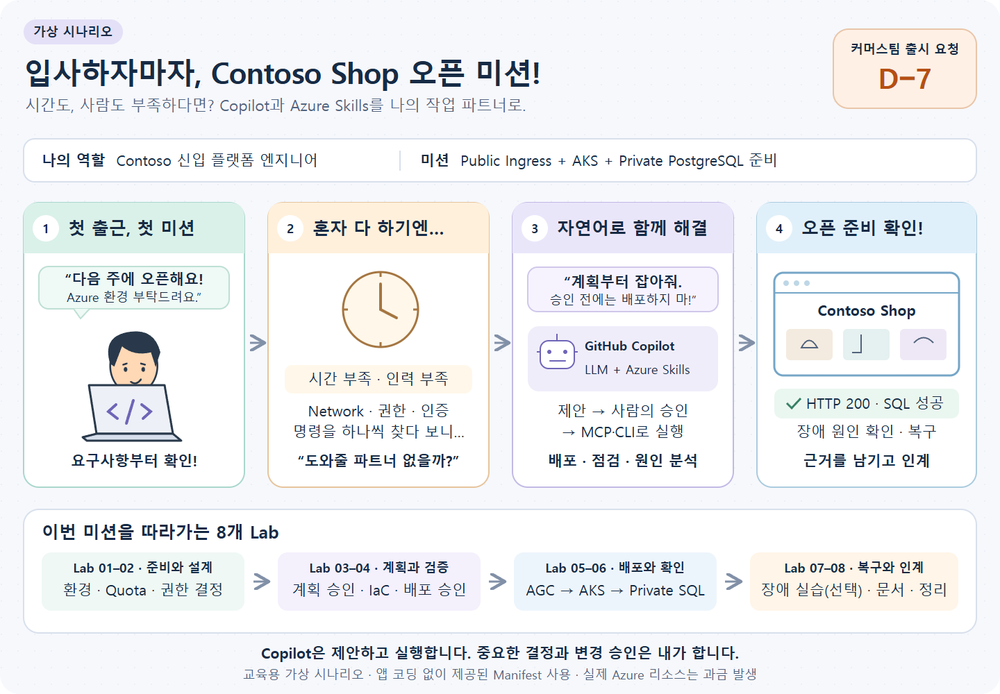
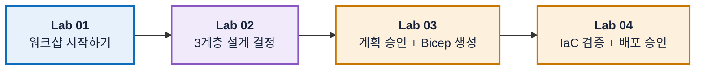
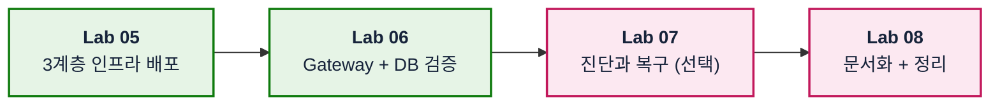

# GitHub Copilot과 Azure Skills로 진행하는 Azure 인프라 워크샵

## 무엇이 다른가요?

명령과 템플릿을 일일이 작성하는 대신,
**GitHub Copilot에 자연어로 요청해 Azure 인프라의 배포·운영 점검·트러블슈팅을 진행합니다.**

GitHub Copilot의 **LLM**(대규모 언어 모델)이 요청을 해석하고,
**Azure Skills**의 작업별 절차·모범 사례에 따라 MCP 도구·CLI를 호출합니다.

- **배포**: 요구사항을 계획과 Bicep으로 만들고, 승인 후 실제 리소스를 생성합니다
- **운영 점검**: 리소스 상태·접근 권한·HTTP·SQL 결과를 확인합니다
- **트러블슈팅**: Events·Pod 상태로 원인을 분석하고, 승인 후 복구·재검증합니다

참가자는 **요구사항 전달·설계 선택·변경 승인**에 집중합니다.
로그인과 Lab의 확인 명령은 직접 실행하며, LLM의 답변은 **실제 실행 결과로 검증합니다.**

## 어떤 시나리오인가요?



**입사 직후, 일주일 안에 Contoso Shop 출시 환경을 준비하라는 요청을 받았습니다.**
시간·인력이 부족한 상황에서 Copilot과 Azure Skills로 교육용 3계층 환경을 구성·검증·인계합니다.

앱 코딩·이미지 빌드는 제외합니다. 제공된 Manifest로 연결·인증을 확인합니다.

## 🎯 워크샵 목표

1. Copilot과 Azure Skills로 `설계 → 승인 → 코드 → 검증 → 배포`를 진행합니다.
2. 결정 근거와 관측 결과를 인계 문서에 남깁니다.
3. Public HTTP와 Private SQL로 동작을 확인합니다.
4. 장애 증거를 분석하고 승인 후 복구합니다.

## 🏁 배포할 아키텍처


- **Application Gateway for Containers (AGC)**: Gateway API 기반 Public Ingress
- **Azure Kubernetes Service**: System/User Node Pool과 Cilium Network Policy
- **PostgreSQL Flexible Server**: Private Subnet과 Microsoft Entra 인증
- **Workload Identity**: Password 없이 Azure Kubernetes Service에서 PostgreSQL 연결

## 🖥️ 확인할 화면


**Contoso Shop** 화면 하단에 응답 Pod 이름이 표시됩니다. Pod를 재생성하면 이름이 바뀝니다.

앱 이미지는 빌드하지 않습니다.

- **ConfigMap**으로 공개 NGINX 이미지에 화면을 넣습니다
- **Downward API**로 Pod 이름과 Namespace를 전달합니다
- 앱 코딩·이미지 빌드 없이 Manifest를 적용합니다

## 🗺️ 진행 순서

**1부 · 설계와 검증**



**2부 · 실행과 마무리**



앞 Lab의 결과물이 다음 Lab의 입력입니다. Lab은 순서대로 진행합니다.

- 각 Lab의 **완료 체크리스트를 확인한 뒤** 다음 Lab으로 넘어갑니다
- 오류·미승인 항목이 있으면 해당 단계에서 멈춥니다
- 명령은 저장소 루트의 Bash 터미널에서 실행합니다. 새 터미널에서는 `.env`와 `KUBECONFIG`를 다시 설정합니다
- Lab 07만 선택입니다. 중간에 중단해도 생성된 리소스 정리는 Lab 08을 참고합니다

| Lab | 주 Skill | 다음 Lab에 넘길 것 |
| --- | --- | --- |
| [01. 워크샵 시작하기](docs/labs/01-orientation-and-setup.md) | `azure-resource-lookup` | `.env`, 확인된 Scope |
| [02. 3계층 설계 결정하기](docs/labs/02-design-aks.md) | `azure-quotas`, `azure-kubernetes`, `azure-enterprise-infra-planner` | Quota, Network, SKU 결정 |
| [03. 계획 승인 + Bicep 생성](docs/labs/03-plan-and-bicep.md) | `azure-enterprise-infra-planner` | 승인된 계획, Bicep |
| [04. IaC 검증 + 배포 승인](docs/labs/04-validate-and-approve.md) | `azure-enterprise-infra-planner` | 검증 증거, 배포 승인 |
| [05. 3계층 인프라 배포](docs/labs/05-deploy-and-connect.md) | `azure-enterprise-infra-planner` | AGC Add-on, Azure Kubernetes Service, PostgreSQL |
| [06. Gateway + DB 검증](docs/labs/06-run-sample-workload.md) | `kubectl` | Public URL, PostgreSQL Query |
| [07. 진단과 복구 (선택)](docs/labs/07-diagnose-and-recover.md) | `azure-diagnostics` | 원인·복구 기록 |
| [08. 문서화 + 정리](docs/labs/08-document-and-cleanup.md) | `azure-resource-visualizer` | 인계 문서, 삭제 증거 |

## 🚀 시작하기

Codespace를 열고 Lab 01부터 순서대로 진행합니다.

### 1. Azure 권한을 확인합니다

다음 권한이 필요합니다.

- Resource Group에 Azure Kubernetes Service, Application Gateway for Containers, PostgreSQL을 배포할 권한
- 제한된 Kubernetes 접근용 Custom Role 생성과 역할 할당 권한 ([Lab 05](docs/labs/05-deploy-and-connect.md))
- 실습이 끝난 뒤 리소스를 **삭제**할 권한

**권한 부족을 해결하려고 Owner나 Cluster Admin을 새로 부여하지 않습니다.**

- 필요한 작업과 실습 Scope에 한정된 권한을 승인받거나, 권한이 있는 다른 전용 Scope를 사용합니다
- 이미 Owner인 계정도 참여할 수 있습니다. 다만 Azure Owner와 Kubernetes 접근 권한은 별개입니다
- Kubernetes 접근은 [Lab 05](docs/labs/05-deploy-and-connect.md)의 제한된 역할로 준비합니다

> [!WARNING]
> **실제 비용이 발생하는 리소스**를 만듭니다.
>
> - Azure Kubernetes Service Node는 실행되는 동안 계속 과금됩니다
> - 중간에 멈춰도 [Lab 08](docs/labs/08-document-and-cleanup.md)의 정리 단계는 진행하여 리소스를 삭제하세요.
> - 회사 공용 Subscription에서는 **전용 Resource Group**을 만들어 사용합니다

### 2. Codespace를 엽니다

[](https://codespaces.new/wonsungso/azure-infra-skills-workshop)

Azure CLI, Bicep, `kubectl`, `kubelogin`과 Azure Skill 6개가 준비됩니다.

컨테이너 준비 후 도구를 확인합니다.

> 💻 **터미널에서 실행**

```bash
az version && az bicep version && kubectl version --client && kubelogin --version
jq --version
ls .github/skills
```

Azure 로그인과 Skill 동작 확인은 [Lab 01](docs/labs/01-orientation-and-setup.md)에서 합니다.

로컬 VS Code로도 진행할 수 있습니다.

- 위 도구를 직접 설치합니다
- [`init-workshop.sh`](scripts/init-workshop.sh)를 한 번 실행합니다
- 이후 Lab은 Codespace와 동일합니다

### 3. Lab 01부터 순서대로 진행합니다

[Lab 01: 워크샵 시작하기](docs/labs/01-orientation-and-setup.md)에서 시작합니다.

<details>
<summary>진행이 중간에 끊겼다면</summary>

새 세션에서 현재 상태를 확인합니다.

> 💬 **Copilot 채팅에 붙여넣기**

```text
현재 진행 상태와 다음 단계를 알려줘.

[읽을 값]
- 저장소 루트의 .env와 infra-report.md

[확인할 것]
- Azure 실제 상태와 보고서 비교
- 완료 단계, 다음 미완료 단계와 선행 조건

[제약]
- Azure 리소스를 변경하지 마
```

</details>

## 💻 Skill과 도구

| Skill / 도구 | 역할 |
| --- | --- |
| `azure-resource-lookup` | 실제 자원을 읽기 전용으로 조회 |
| `azure-quotas` | vCPU Quota와 Region 용량 확인 |
| `azure-kubernetes` | Azure Kubernetes Service Day-0 설계 검토 |
| `azure-enterprise-infra-planner` | PostgreSQL Network·인증과 Least Privilege 검토, 계획 승인, Bicep 생성·검증·배포 |
| `azure-diagnostics` | 증거 기반 오류 진단 |
| `azure-resource-visualizer` | 리소스 관계를 다이어그램으로 정리 |
| MCP 도구 / CLI / `kubectl` | 제안을 실제로 실행 |

Skill은 판단과 절차를, 도구는 실행을 담당합니다.

- Skill 이름이 아니라 실제 도구 호출과 결과를 확인합니다
- [`add-report.sh`](scripts/add-report.sh)로 검토 결과를 `infra-report.md`에 기록합니다

## ⚡ 작업 방식 비교

| 방식 | 해주는 것 | 빠지는 것 |
| --- | --- | --- |
| 🖐 **수동** (포털·CLI) | 직접 결정하고 실행 | 근거·결과를 별도로 기록 |
| 💬 **일반 프롬프트** | 명령과 템플릿 생성 | 실제 조회·승인·검증을 별도로 지시 |
| ⚡ **Skill** | 절차·안전 조건·검증 순서 제공 | 사람이 검토하고 승인 |

핵심은 **Quota 확인 → 계획 승인 → 배포 전 검증**입니다.
각 Lab의 접힌 비교 표에서 작업 방식별 차이를 확인할 수 있습니다.

## 📂 자료 구분

| 위치 | 내용 |
| --- | --- |
| [`docs/labs/`](docs/labs/) | Lab 01–08의 절차·프롬프트·입력값 |
| [`reference/infra/`](reference/infra/) | 비교용 Bicep 기준본 |
| [`reference/kubernetes/`](reference/kubernetes/) | 웹·Gateway API·PostgreSQL 검증 Manifest |
| [`templates/`](templates/) | Lab 08 [인계 양식](templates/handoff-template.md) |
| [`.devcontainer/`](.devcontainer/) | Codespace 환경 |
| [`scripts/`](scripts/) | [초기화](scripts/init-workshop.sh)·[값 반영](scripts/set-env.sh)·[보고서](scripts/add-report.sh)·[접근 준비](scripts/prepare-aks-access.sh) |

Lab 구성: 목표 → 왜 필요한가 → 시작 전에 → Step → 완료 체크리스트 → 문제 해결 → 다음 Lab.

## 🛡️ 안전 경계

- 배포·역할 변경·장애 주입·삭제는 **대상과 영향을 확인한 뒤 승인**하고 수행합니다.
- 실행 결과가 없는 내용은 `예상` 또는 `미검증`으로 표기합니다.
- Authorized IP Ranges에 `0.0.0.0/0`을 넣지 않습니다. 접속이 안 되면 내 Egress IP부터 다시 확인합니다.
- 샘플은 `lab` Namespace에서만 실행합니다. 외부 진입점은 Application Gateway for Containers만 사용합니다.
- Subscription ID, Tenant ID, Kubeconfig 내용은 저장소에 기록하지 않습니다([AGENTS.md](AGENTS.md) 참고).

---

### ➡️ [Lab 01 시작하기](docs/labs/01-orientation-and-setup.md)
