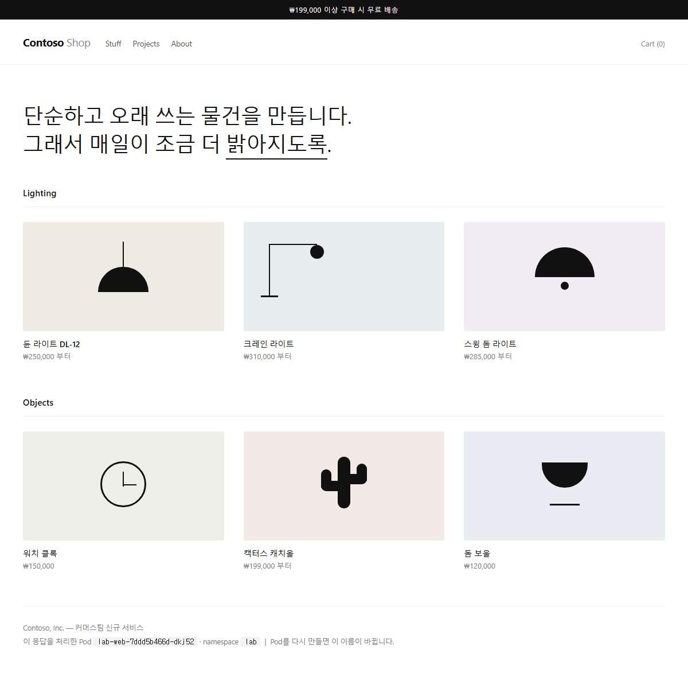
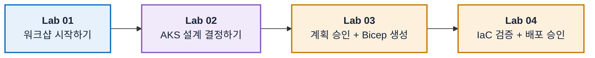
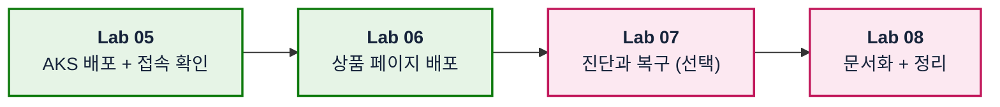

# Azure Skills 기반 AKS 워크샵

## 🔥 오늘, 당신은 Contoso의 플랫폼 엔지니어입니다

**D-7.** 커머스팀의 신규 서비스 출시가 일주일 앞인데, 개발팀이 코드를 올릴 **Kubernetes 환경이 아직 없습니다.** 팀장이 첫 임무를 건넵니다.

> 🗣️ **"팀 전용 AKS 환경을 오늘 안에 준비해 주세요."**
>
> 1. **클릭으로 만들지 마세요.** `설계 → 승인 → 코드 → 검증 → 배포` 순서로.
> 2. **왜 그렇게 만들었는지 남기세요.** 다음 사람이 이어받을 수 있게.
> 3. **동작한다는 걸 증명하세요.** 실제로 트래픽을 처리하는 화면으로.

무기는 CLI 암기가 아니라 **Azure Skills**입니다. Skill이 대안·위험·비용을 정리해 제안하면, 여러분은 **검토하고 승인하고 결과를 조회로 검증**합니다. AKS는 그 감각을 연습하는 무대일 뿐입니다.

## 🏁 6시간 뒤 도달할 화면



커머스팀이 출시할 **Contoso Shop**입니다. 화면 아래 **응답을 처리한 Pod 이름**은 고정 텍스트가 아니라 지금 트래픽을 받고 있는 실제 Pod입니다. Pod를 다시 만들면 이름이 바뀝니다.

> [!NOTE]
> 컨테이너 이미지를 빌드하지 않습니다. 공개 nginx 이미지에 **ConfigMap**으로 화면을 주입하고 **Downward API**로 Pod 정보를 전달합니다. 앱 코딩 없이 manifest만으로 만듭니다.

## 🗺️ 오늘의 여정

**1부 · 설계와 검증**



**2부 · 실행과 마무리**



앞 Lab의 결과물이 다음 Lab의 입력입니다. 순서를 건너뛰지 마세요.

| Lab | 시간 | 주 Skill | 다음 Lab에 넘길 것 |
| --- | --- | --- | --- |
| [01. 워크샵 시작하기](docs/labs/01-orientation-and-setup.md) | 30분 | `azure-resource-lookup` | 입력표, 확인된 scope |
| [02. AKS 설계 결정하기](docs/labs/02-design-aks.md) | 45분 | `azure-quotas`, `azure-kubernetes`, `azure-rbac` | quota 확인 결과, Day-0 결정표 |
| [03. 계획 승인 + Bicep 생성](docs/labs/03-plan-and-bicep.md) | 55분 | `azure-enterprise-infra-planner` | 승인된 계획, Bicep |
| [04. IaC 검증 + 배포 승인](docs/labs/04-validate-and-approve.md) | 45분 | `azure-enterprise-infra-planner` | 검증 증거, 배포 승인 |
| [05. AKS 배포 + 접속 확인](docs/labs/05-deploy-and-connect.md) | 45분 | `azure-resource-lookup` | Ready 클러스터, `lab` namespace |
| [06. 상품 페이지 배포](docs/labs/06-run-sample-workload.md) | 40분 | 도구 실행 | 동작하는 상품 페이지 |
| [07. 진단과 복구 (선택)](docs/labs/07-diagnose-and-recover.md) | 30분 | `azure-diagnostics` | 원인·복구 기록 |
| [08. 문서화 + 정리](docs/labs/08-document-and-cleanup.md) | 50분 | `azure-resource-visualizer` | 인계 문서, 삭제 증거 |

실습 시간만 더하면 약 5시간 40분입니다. 시간이 부족하면 Lab 07을 생략하고 Lab 08의 정리 시간을 확보하세요.

## 🚀 시작하기

혼자서 끝까지 진행할 수 있게 만들어졌습니다. 사전 세팅을 받지 않아도 됩니다.

### 1. Azure 권한을 확인합니다

다음 두 가지를 **본인이 직접** 할 수 있어야 합니다. 하나라도 안 되면 끝까지 진행할 수 없습니다.

- resource group을 만들고 그 안에 AKS를 배포할 권한 (예: 해당 scope의 `Contributor`)
- 실습이 끝난 뒤 리소스를 **삭제**할 권한

> [!IMPORTANT]
> **실제 비용이 발생하는 리소스**를 만듭니다. AKS node는 실행되는 동안 계속 과금되므로, 중간에 그만두더라도 [Lab 08](docs/labs/08-document-and-cleanup.md)의 정리 단계는 반드시 수행하세요. 회사 공용 subscription이라면 **전용 resource group**을 새로 만들어 진행하세요.

### 2. Codespace를 엽니다

[](https://codespaces.new/wonsungso/azure-infra-skills-workshop)

Azure CLI, Bicep, `kubectl`, `kubelogin`이 설치된 상태로 열립니다. 로컬에 아무것도 깔지 않아도 됩니다. 컨테이너 준비가 끝나면 터미널에서 로그인합니다.

```bash
az login
az version && az bicep version && kubectl version --client && kubelogin --version
```

> [!NOTE]
> 로컬 VS Code로 진행해도 됩니다. 그때는 위 도구를 직접 설치하세요. 이후 Lab은 두 경우 모두 동일합니다.

### 3. workshop ID를 확인합니다

Codespace가 만들어질 때 6글자 ID가 **자동으로 생성되어** `my-inputs.md`에 채워집니다. 직접 만들 필요가 없습니다.

```bash
cat my-inputs.md
```

이 ID는 **모든 리소스 이름에 공통으로** 들어갑니다.

| 리소스 | 이름 |
| --- | --- |
| resource group | `rg-aks-lab-<ID>` |
| VNet | `vnet-aks-lab-<ID>` |
| AKS | `aks-lab-<ID>` |

같은 ID를 쓰면 내 리소스를 한눈에 찾을 수 있고, 여러 명이 같은 subscription에서 진행해도 이름이 겹치지 않습니다. VNet과 AKS 이름은 Bicep이 ID로부터 만들므로 직접 짓지 않습니다.

> [!NOTE]
> Codespace를 쓰지 않는다면 아래 명령으로 같은 파일을 만듭니다. 파일이 이미 있으면 덮어쓰지 않습니다.
>
> ```bash
> bash scripts/init-workshop.sh
> ```

### 4. Lab 01부터 순서대로 진행합니다

[Lab 01: 워크샵 시작하기](docs/labs/01-orientation-and-setup.md)로 이동하세요. 배경이 궁금하면 [설계 결정](docs/design-decisions.md)을 참고할 수 있지만, 읽지 않아도 진행에는 지장이 없습니다.

<details>
<summary>진행이 중간에 끊겼다면</summary>

새 세션에서 아래 프롬프트로 현재 상태부터 이어갑니다.

```text
이 저장소의 my-inputs.md와 증거 로그를 읽고 현재 완료된 단계를 판별해줘. Azure에서 실제 상태를 조회해 문서와 비교하되 리소스를 변경하지 마. 다음 미완료 단계와 선행 조건만 제시해줘.
```

</details>

## 💻 Skill과 도구

| Skill / 도구 | 역할 |
| --- | --- |
| `azure-resource-lookup` | 실제 자원을 읽기 전용으로 조회 |
| `azure-quotas` | vCPU quota와 region 용량 확인 |
| `azure-kubernetes` | AKS Day-0 설계 검토 |
| `azure-rbac` | least privilege 매트릭스 설계 |
| `azure-enterprise-infra-planner` | 계획 승인, Bicep 생성·검증·배포 |
| `azure-diagnostics` | 증거 기반 오류 진단 |
| `azure-resource-visualizer` | 리소스 관계를 다이어그램으로 정리 |
| MCP 도구 / CLI / `kubectl` | 제안을 실제로 실행 |

Skill은 판단과 절차를, 도구는 실행을 담당합니다. **프롬프트에 Skill 이름을 썼다는 사실만으로는 증거가 되지 않습니다.** 실제 호출과 결과를 [증거 로그](templates/evidence-log.md)에 남기세요.

## ⚡ Skill을 쓰면 무엇이 달라지나

같은 인프라 작업을 세 가지 방식으로 할 수 있습니다.

| 방식 | 해주는 것 | 빠지는 것 |
| --- | --- | --- |
| 🖐 **수동** (포털·CLI) | 내가 모든 것을 결정하고 입력 | 결정 근거가 남지 않음. 문서화는 전부 별도 작업 |
| 💬 **일반 프롬프트** | 그럴듯한 명령어와 템플릿을 빠르게 생성 | **내 subscription의 실제 상태를 모름.** 승인 단계가 없고, 검증 없이 "됐다"고 답하기 쉬움 |
| ⚡ **Skill** | 절차·가드레일·검증 순서를 함께 제공 | 판단과 승인은 여전히 사람 몫 |

핵심 차이는 **속도가 아니라 절차**입니다. 일반 프롬프트도 Bicep을 몇 초 만에 만들어 줍니다. 하지만 "quota를 먼저 확인했는가 → 계획을 승인받았는가 → 배포 전에 검증했는가"라는 순서를 지켜주지는 않습니다. 사고는 대개 그 빠진 순서에서 납니다.

각 Lab에는 **"💡 Skill을 안 썼다면?"** 비교가 접힌 형태로 들어 있습니다. 그 단계를 직접 해본 뒤에 펼쳐 보세요.

## 📂 자료 구분

| 위치 | 내용 |
| --- | --- |
| `docs/labs/` | Lab 01~08 가이드. 프롬프트와 입력값이 모두 이 안에 있습니다 |
| `reference/infra/` | Bicep 기준본 - **정답지가 아니라 비교용** |
| `reference/kubernetes/` | 상품 페이지 manifest - **그대로 사용** |
| `templates/` | 증거 로그, 인계 문서 양식 |
| `.devcontainer/` | Codespace 환경 정의 |
| `scripts/` | workshop ID 생성과 `my-inputs.md` 초기화 |

모든 Lab은 같은 순서를 따릅니다. 목표 → 왜 필요한가 → 시작 전에 → Step → 완료 체크리스트 → 문제가 생겼다면 → 다음 Lab.

## 🛡️ 안전 경계

- 배포·역할 변경·장애 주입·삭제는 **대상과 영향을 확인한 뒤 승인**하고 수행합니다.
- 실행 결과가 없는 내용은 `예상` 또는 `미검증`으로 표기합니다.
- authorized IP ranges에 `0.0.0.0/0`을 넣지 않습니다. 접속이 안 되면 내 egress IP부터 다시 확인합니다.
- 샘플은 `lab` namespace에서만 실행하고 외부 LoadBalancer나 Ingress를 만들지 않습니다.
- subscription ID, tenant ID, kubeconfig 내용은 저장소에 기록하지 않습니다([AGENTS.md](AGENTS.md) 참고).
