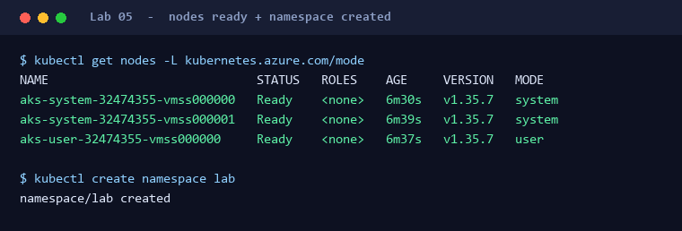

# Lab 05: 3계층 인프라 배포

**Lab 5 / 8** · 2부 · 실행과 마무리

🎯 인프라 배포·제한된 AKS 접근 준비

🧠 `azure-enterprise-infra-planner`

> 🎬 승인된 인프라를 배포하고 실습용 접근만 준비합니다.

## 왜 필요한가요?

- Agent가 승인된 AKS·PostgreSQL·Network·Identity를 배포하고 실제 준비 상태를 확인합니다.
- 별도 권한 승인 후 `lab` Namespace 접근을 준비해, 다음 Lab에서 워크로드를 실행할 수 있게 합니다.
- 배포 성공과 서비스 준비·접속 권한은 서로 다르므로 각각 검증하며, 실제 비용이 발생하기 시작합니다.

## 시작 전에

- [Lab 04](04-validate-and-approve.md)의 검사 통과·배포 승인 기록을 확인합니다.

## Step 1. 배포·접속 준비 맡기기

이 프롬프트는 인프라 배포와 준비 상태 확인을 맡기고, 필요한 접근 권한은 따로 승인받아 설정합니다.

> 🧠 **Skill** `azure-enterprise-infra-planner` &nbsp;·&nbsp; 💬 **Copilot 채팅에 붙여넣기**

```text
azure-enterprise-infra-planner Skill로 승인된 인프라를 배포하고 접근을 준비해줘.

[읽을 값]
- .env, 승인된 계획, infra-report.md의 검증·배포 승인·권한 매트릭스

[진행 순서]
- 승인 범위와 현재 Scope를 확인한 뒤 계획대로 배포
- AKS Succeeded·PostgreSQL Ready, Workload Identity 활성화 확인
- ALB Add-on·Gateway API는 AKS REST API로 확인
- PostgreSQL Public·Password Authentication Disabled 확인
- 현재 사용자·기존 역할을 조회하고 중복·공용 권한은 유지
- scripts/prepare-aks-access.sh의 제한된 역할과 lab 생성 대상·영향을 설명
- 역할·Namespace 변경은 별도로 승인 요청
- 승인 후 bash scripts/workshop.sh connect --approved 실행
- Node Pool 개수·SKU를 승인된 설계와 대조
- 실제 상태·역할 Scope·승인·명령을 infra-report.md에 기록

[제약]
- 배포 승인 기록이 없거나 준비 확인에 실패하면 멈춰
- 역할·Namespace 승인 전에는 connect를 실행하지 마
- Owner·Cluster Admin을 부여하거나 IP 제한을 완화하지 마
- 기존 Custom Role이 다르면 덮어쓰지 마
- 이 Skill을 쓸 수 없으면 다른 방법으로 대신하지 말고 먼저 알려줘
```

**완료 기준:** 서비스·Node·Controller 준비, `lab` 쓰기 허용, `kube-system` 쓰기·Secrets 읽기 거부.

## ✅ 완료 체크리스트

- [ ] 실제 배포·서비스 준비 상태를 확인했다
- [ ] `lab` 접근·권한 경계와 승인된 Node 구성이 일치한다
- [ ] `NODE_RESOURCE_GROUP`과 실행·권한 기록이 남았다

## 🚧 문제가 생겼다면

<details>
<summary>🔎 <b>접근 권한과 연결 오류</b></summary>

| 역할 | Scope |
| --- | --- |
| Cluster User | 해당 AKS의 Entra Credentials 조회 |
| bootstrap Custom Role | cluster 조회·Namespace 준비, Secrets 읽기 제외 |
| RBAC Admin | `lab`만 워크로드·Custom Resource 쓰기 |
| RBAC Reader | `kube-system` Controller 조회·Log |

Namespace는 Kubernetes의 작업 구분 공간입니다. Azure Owner만으로 Kubernetes 접근은 허용되지 않습니다.
[`workshop.sh`](../../scripts/workshop.sh)는 [`prepare-aks-access.sh`](../../scripts/prepare-aks-access.sh)를 재사용합니다.
기존 Namespace는 유지하며, 역할·Controller 준비를 기다리다 시간 초과하면 멈춥니다.

| 문제 | 다음 조치 |
| --- | --- |
| Forbidden | 실제 역할·Scope·전파 상태 확인. 중복 할당·권한 확대 금지 |
| kube-system 쓰기·Secrets 읽기 허용 | 기존 권한을 조사. 격리 성공으로 기록하거나 공용 역할을 삭제하지 않음 |
| API Server 접속 불가 | Egress IP 비교 후 변경된 /32만 승인받아 반영. `0.0.0.0/0` 금지 |
| CLI의 ingressProfile이 null | 실제 REST API로 확인. 비활성화로 단정하지 않음 |
| Quota·Policy 오류 | [Lab 02](02-design-aks.md)·[Lab 04](04-validate-and-approve.md)로 돌아가 원인 해결 |



AGC 본체는 다음 Lab의 Manifest 적용 때 생성됩니다. Node Resource Group의 Load Balancer는 Egress용입니다.

</details>

## 다음 Lab

준비·권한 경계를 확인한 뒤 [Lab 06: Gateway + DB 검증](06-run-sample-workload.md)으로 이동합니다.
