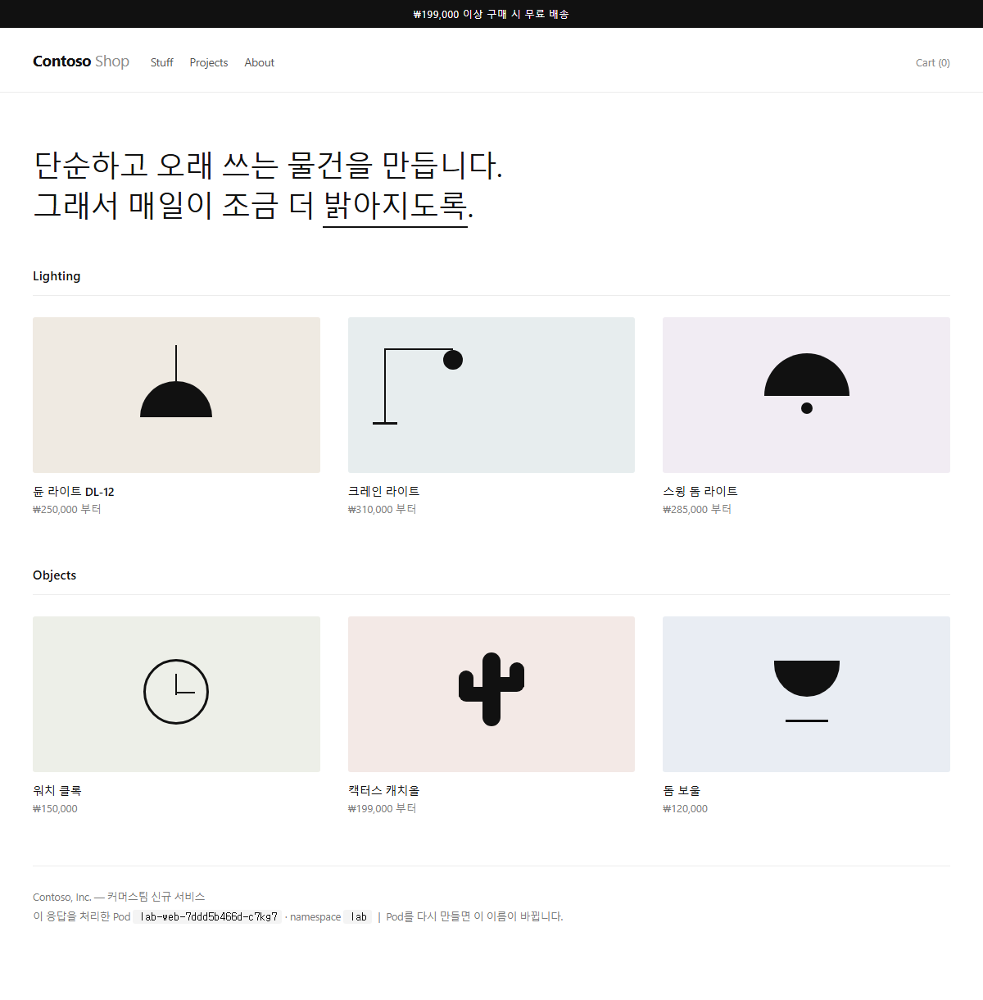

# Lab 06: Gateway + Database 검증

**Lab 6 / 8** · 2부 · 실행과 마무리

🎯 Public HTTP·Private SQL·Pod 재생성 검증

🧠 Skill 없이 도구만 사용합니다

> 🎬 Agent가 실행하고, 실제 상품 화면과 SQL 결과로 확인합니다.

## 왜 필요한가요?

- Agent가 워크로드를 적용하고 Gateway → AKS → PostgreSQL 요청 경로를 실제 HTTP·SQL로 확인합니다.
- 상품 Row와 응답 Pod를 대조하고, Pod 재생성 후에도 같은 URL에서 새 Pod가 응답하는지 검증합니다.
- 리소스가 준비됐다는 상태값만으로는 연결·인증·요청 전달이 성공했다고 판단할 수 없기 때문입니다.

## 시작 전에

- [Lab 05](05-deploy-and-connect.md)의 서비스·`lab` 접근 준비를 마칩니다.

## Step 1. 적용·E2E 검증 맡기기

이 프롬프트는 적용과 최초 E2E를 검증한 뒤, 별도 승인을 받아 Pod 재생성 전후를 비교합니다.

> 💬 **Copilot 채팅에 붙여넣기**

```text
워크로드를 검토·적용하고 실제 E2E와 Pod 재생성을 검증해줘.

[진행 순서]
- .env와 reference/kubernetes/lab-web.yaml, scripts/workshop.sh를 읽어줘
- 적용 대상과 AGC 비용·Workload Identity SQL 검증을 설명하고 승인 요청
- 승인 후 bash scripts/workshop.sh apply --approved 실행
- Gateway·HTTPRoute 준비, HTTP 200, SQL successful_checks=1,
  정확한 상품 Row·실제 응답 Pod·User Pool을 확인하고 URL을 보여줘
- 최초 E2E 통과 후 Web Pod 삭제 대상·일시 중단 영향을 설명하고 별도 승인 요청
- 승인 후 bash scripts/workshop.sh restart --approved 실행
- 같은 URL·새 Pod 이름·동일 SQL 상품을 대조
- 실제 명령·결과를 infra-report.md의 Workload 장에 기록

[제약]
- 승인 전에는 적용하지 마
- 승인 전에는 Pod를 삭제하지 마
- 실패하면 Events·Pod 상태·오류를 기록하고 멈춰
- 복구 후 점검에는 apply·restart를 반복하지 마
```

**완료 기준:** HTTP·SQL·Pod 대조 통과, 재생성 후에도 같은 URL에서 새 Pod가 응답합니다.

## Step 2. 화면·결과 확인하기

Agent가 보여준 Public URL을 브라우저에서 열고 상품·Pod 이름을 결과표와 비교합니다.


## ✅ 완료 체크리스트

- [ ] Public HTTP·Private SQL이 실제로 성공했다
- [ ] 상품 Row·응답 Pod·User Pool이 일치한다
- [ ] Pod 재생성 전후 결과가 기록됐다

## 🚧 문제가 생겼다면

<details>
<summary>🔎 <b>계층별 증거와 읽기 전용 재검증</b></summary>

| 증거 | 통과 조건 |
| --- | --- |
| Gateway / HTTPRoute | Accepted·Programmed / Accepted·ResolvedRefs=True |
| SQL Job | Complete, successful_checks=1 |
| Public HTTP 상품 | `Dune Light DL-12 · KRW 250000` 정확히 일치 |
| 응답 Pod | 실제 Ready Pod, `lab` Namespace, User Pool |

상품 Row는 Web Pod가 Private PostgreSQL에서 읽은 값입니다. HTTP 200만으로 통과하지 않습니다.
[`workshop.sh`](../../scripts/workshop.sh)는 기존 [Renderer](../../scripts/render-workload.sh)와
[HTTP 검사](../../scripts/verify-public-http.sh)를 재사용하고 매번 같은 Kubeconfig 대상을 확인합니다.

> 💬 **Copilot 채팅에 붙여넣기**

```text
현재 워크로드를 변경 없이 재검증해줘.

[할 일]
- bash scripts/workshop.sh verify 실행
- Gateway·HTTPRoute·HTTP·SQL·응답 Pod 대조 결과를 보고서에 기록

[제약]
- Manifest를 다시 적용하거나 Pod를 삭제하지 마
- 실패를 성공으로 기록하지 마
```

| 증상 | 확인할 근거 |
| --- | --- |
| Pod Pending / ImagePullBackOff | Node·Taint·Events·이미지 참조 |
| SQL 실패 | Private DNS·TLS·Federated Credential·Entra 인증 |
| Gateway 준비 지연 | ALB 상태·Controller Log. 최대 대기 후 실패 시 재배포하지 않음 |



</details>

## 다음 Lab

E2E를 마친 뒤 선택 실습인 [Lab 07: 진단과 복구](07-diagnose-and-recover.md)로 이동합니다.
장애 실습을 건너뛰려면 [Lab 08: 문서화 + 정리](08-document-and-cleanup.md)로 이동합니다.
