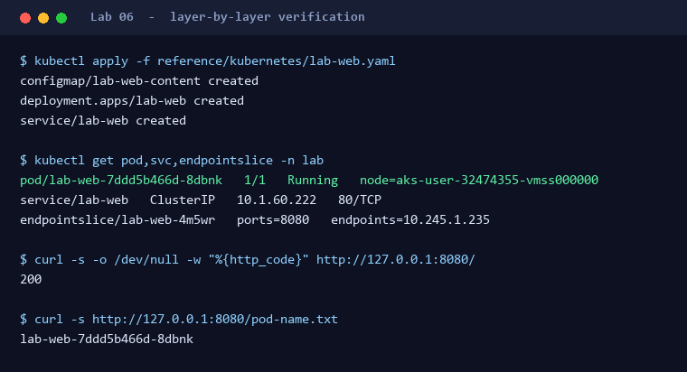

# Lab 06: 상품 페이지 배포

**Lab 6 / 8** · 2부 · 실행과 마무리 · ⏱ 40분

🎯 이미지 빌드 없이 ConfigMap과 Downward API로 화면 올리기 / 계층별로 나눠 검증하기

🧠 Skill 없이 도구만 사용합니다

> 🎬 클러스터는 살아있습니다. 하지만 팀장이 보고 싶은 건 `kubectl get nodes` 결과가 아닙니다. **눈에 보이는 화면**을 올릴 차례입니다.

## 왜 필요한가요?

팀장의 세 번째 조건은 **"살아있다는 걸 증명하세요"** 였습니다. 지금까지는 클러스터가 있다는 것까지만 보였으니, 이제 실제로 **트래픽을 처리하는 화면**을 올립니다.

다만 "배포했다"와 "정상 동작한다"는 다릅니다. Deployment가 `Available`이어도 Pod가 `Ready`가 아닐 수 있고, Service가 있어도 트래픽이 전달되지 않을 수 있습니다. 그래서 계층을 따로따로 확인합니다.

## 시작 전에

- [Lab 05](05-deploy-and-connect.md)에서 `lab` namespace 접근을 확인했나요?

## Step 1. manifest 검토하기 (10분)

> 📋 **아래 프롬프트를 복사해 실행**

```text
reference/kubernetes/lab-web.yaml을 검토해줘. ConfigMap으로 주입되는 index.html, projected volume이 ConfigMap과 Downward API를 합치는 방식, namespace, nodeSelector, non-root 보안 설정, requests/limits, readiness/liveness, ClusterIP Service를 설명하고 적용 대상과 검증 순서를 제시해줘. 적용하지 마.
```

**이 manifest의 핵심 아이디어** - 화면을 보여주려고 새 컨테이너 이미지를 만들지 않습니다. 대신 세 조각을 조립합니다.

| 조각 | 역할 |
| --- | --- |
| `ConfigMap/lab-web-content` | 상품 페이지 `index.html` (외부 CDN 없이 CSS 내장) |
| `projected` volume → Downward API | 실행 중인 Pod 이름과 namespace를 파일로 주입 |
| `nginx-unprivileged` 이미지 | 위 두 조각을 합쳐 `/usr/share/nginx/html`로 서빙 |

그래서 페이지에 뜨는 Pod 이름은 **하드코딩된 값이 아니라 지금 응답하는 실제 Pod**입니다.

**확인할 것:** 외부에 노출하는 LoadBalancer나 Ingress가 없는지, 그리고 `lab` 이외의 namespace를 건드리지 않는지.

## Step 2. 적용하고 계층별로 검증하기 (20분)

승인 후 `lab` namespace에만 manifest를 적용합니다. 아래 항목을 하나씩, 개별적으로 확인하세요.

| 확인 항목 | 무엇을 보는가 |
| --- | --- |
| ConfigMap | `lab-web-content`가 `lab` namespace에 생성됐는가? |
| Deployment | `Available` 상태인가? |
| Pod | user pool에 배치되고 `Ready`인가? |
| Service / EndpointSlice | selector가 실제 Pod와 연결되는가? |
| HTTP 응답 | localhost-bound port-forward로 응답이 오는가? |

> [!WARNING]
> port-forward 성공은 "로컬에서 접근이 됐다"는 것만 증명합니다. 외부 공개나 클러스터 내부 DNS 통신이 된다는 증거로 기록하지 마세요.

각 계층이 정상이면 아래와 같이 보입니다. **EndpointSlice의 `endpoints` 값이 Pod IP와 같은지**가 Service와 Pod가 실제로 연결됐다는 증거입니다.



<details>
<summary>💡 <b>Skill을 안 썼다면?</b></summary>

| 방식 | 이 단계에서 벌어지는 일 |
| --- | --- |
| 🖐 수동 | `kubectl apply` 후 무엇을 확인해야 정상인지 스스로 정해야 한다. |
| 💬 일반 프롬프트 | `apply`가 성공하면 "배포 완료"라고 답하기 쉽다. Pod가 `Ready`인지, Service가 Pod와 **실제로 연결됐는지**는 확인하지 않는다. |
| ⚡ 이 랩은 Skill 없이 | 도구만 씁니다. 대신 **계층별 확인 순서**를 문서가 제공합니다. 무엇을 봐야 하는지 아는 것 자체가 이 랩의 학습 목표입니다. |

</details>

## Step 3. 상품 페이지 열어보기 (10분)

port-forward를 연 상태에서 브라우저로 `http://127.0.0.1:8080` 에 접속해 **Contoso Shop** 화면을 확인하세요.

Codespace에서는 port-forward를 시작하면 VS Code가 8080 포트를 자동으로 감지합니다. 하단 **포트(Ports) 패널**에서 지구본 아이콘을 누르면 브라우저로 열립니다. 이때 주소는 `127.0.0.1`이 아니라 `...app.github.dev` 형태입니다. 이것은 Codespace 내부로의 터널일 뿐이므로, 클러스터를 외부에 공개한 것이 아닙니다.


화면 아래의 Pod 이름과 터미널에서 조회한 이름이 **같은지** 비교해 보세요. 같다면 화면이 정말로 내 클러스터에서 오고 있다는 증거입니다. `-o wide`로 조회한 node가 **user pool**인지도 확인하세요. Lab 02 설계 결정이 실제로 지켜졌다는 증거입니다.

Pod를 지우고 재생성된 뒤 페이지를 새로고침해 보세요. **하단의 Pod 이름이 바뀝니다.** 재생성이 눈으로 보이는 순간입니다.

```bash
kubectl delete pod -n lab -l app=lab-web
```

port-forward는 Pod가 바뀌면 끊어지므로 다시 실행해야 합니다.


## ✅ 완료 체크리스트

- [ ] ConfigMap, Deployment, Pod, Service, HTTP 응답을 각각 따로 기록함
- [ ] 페이지에 표시된 Pod 이름이 조회 결과와 일치함
- [ ] Pod가 user pool node에 배치된 것을 확인함
- [ ] 다른 namespace나 외부 노출 자원을 만들지 않음
- [ ] 실패 시 Events와 Pod 상태를 수집함

## 🚧 문제가 생겼다면

| 증상 | 원인일 가능성 | 해야 할 일 |
| --- | --- | --- |
| Pod가 `Pending` | 스케줄링 제약(nodeSelector) 또는 리소스 부족 | node 상태와 taint/toleration 확인 |
| Pod가 `ImagePullBackOff` | 이미지 태그/digest 오류 | manifest의 이미지 값 재확인 |
| Pod가 `ContainerCreating`에서 멈춤 | ConfigMap을 먼저 적용하지 않았을 수 있음 | `lab-web-content` ConfigMap 존재 여부 확인 |
| 화면은 뜨는데 Pod 이름이 `-` | Downward API 파일 경로 불일치 | manifest의 `path` 값과 HTML의 fetch 대상 비교 |
| port-forward 응답 없음 | 앱이 아직 `Ready` 아님 | 몇 초 대기 후 Pod 상태 재확인 |

## 다음 Lab

[Lab 07: 진단과 복구](07-diagnose-and-recover.md) - 시간이 부족하면 [Lab 08: 문서화 + 정리](08-document-and-cleanup.md)로 바로 갑니다.
