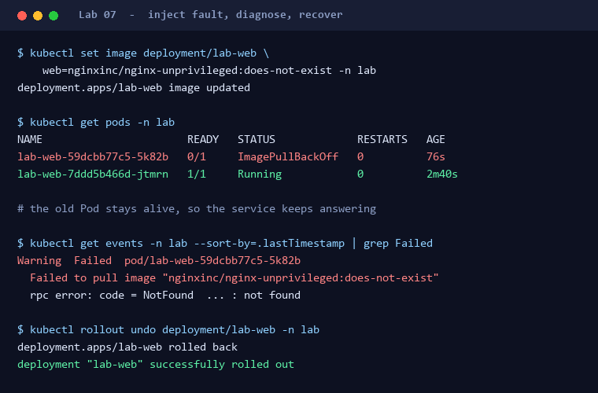

# Lab 07: 진단과 복구 (선택)

**Lab 7 / 8** · 2부 · 실행과 마무리 · ⏱ 30분 · 생략 가능

🎯 증거(Events·Pod 상태·이미지 참조)만으로 원인 판단 / 승인 후 복구

🧠 `azure-diagnostics`

> 🎬 데모를 앞두고 무언가 이상합니다. 가장 위험한 건 **추측으로 고치는 것**입니다. 근거를 먼저 모읍니다.

## 왜 필요한가요?

중요한 것은 "그럴듯한 추측"이 아니라 **증거 기반 진단**입니다. 여기서는 장애를 직접 만들어 보고 증거로 찾아내 복구합니다. 원인을 아는 상태로 연습하는 이유는, 진짜 장애 때 쓸 **절차**를 몸에 익히기 위해서입니다.

## 시작 전에

- [Lab 06](06-run-sample-workload.md)의 정상 상태 증거가 있나요? 복구 여부를 판단할 기준이 됩니다.
- **내 실습용 클러스터에서만** 진행합니다. 공용 환경에 장애를 주입하지 마세요.

## Step 1. 장애를 직접 주입하기

존재하지 않는 이미지 태그로 바꿔 Pod가 뜨지 못하게 만듭니다.

```bash
bash scripts/log-evidence.sh "Lab 07 Step 1" "kubectl" -- \
  kubectl set image deployment/lab-web web=nginxinc/nginx-unprivileged:does-not-exist -n lab
```

지금 원인을 알고 있더라도, **다음 Step에서는 모르는 척하고 증거만으로 결론을 내리세요.** 아는 답을 확인하는 게 아니라, 증거를 읽는 순서를 연습하는 것이 목적입니다.

## Step 2. 증거로 원인 분석하기

> 🧠 **Skill** `azure-diagnostics` &nbsp;·&nbsp; 📋 **아래 프롬프트를 복사해 실행**

```text
azure-diagnostics를 사용해 lab namespace의 샘플 Deployment가 준비되지 않는 원인을 읽기 중심으로 분석해줘. Events, Pod 상태, 이미지 참조를 근거로 원인을 제시하고 영향 범위와 복구 변경을 설명한 뒤 적용 승인 전에는 멈춰.
```

**확인할 것**

- 제시된 원인이 **실제 Events 문구**에 근거하는가, 아니면 일반론인가?
- 기존 Pod는 아직 살아있는가? (Deployment는 새 Pod가 Ready가 되기 전까지 기존 Pod를 지우지 않습니다)

실제로 실행하면 아래처럼 보입니다. 새 Pod는 `ImagePullBackOff`지만 **기존 Pod는 `1/1 Running`으로 남아 서비스가 계속 응답한다**는 점을 확인하세요.



<details>
<summary>💡 <b>Skill을 안 썼다면?</b></summary>

| 방식 | 이 단계에서 벌어지는 일 |
| --- | --- |
| 🖐 수동 | describe·events·logs를 어떤 순서로 볼지 스스로 정해야 한다. |
| 💬 일반 프롬프트 | 증상만 듣고 **가장 흔한 원인을 단정**한다. 실제 Events를 읽지 않으므로 이번 장애의 원인이 아닐 수 있다. |
| ⚡ Skill | 증거 수집 순서를 정하고, 결론에 **실제 Events 문구를 근거로** 인용하게 한다. |

</details>

## Step 3. 승인 후 복구하고 재검증하기

복구 변경(올바른 이미지로 되돌리기)을 승인한 뒤 적용하고, [Lab 06](06-run-sample-workload.md)의 계층별 확인을 다시 수행합니다.

```bash
bash scripts/log-evidence.sh "Lab 07 Step 3" "kubectl" -- \
  kubectl rollout undo deployment/lab-web -n lab
```

`rollout undo`로 복구하면 **페이지의 Pod 이름은 바뀜지 않습니다.** 기존 Pod가 한 번도 죽지 않았기 때문입니다. 이름이 그대로인 것이 오히려 "무중단으로 막았다"는 증거입니다. 이름이 바뀜는 것을 보고 싶다면 [Lab 06](06-run-sample-workload.md)의 Pod 삭제 실험을 따로 해보세요.

권한 확대, IP 제한 완화, namespace 삭제는 복구 수단이 아닙니다.

## ✅ 완료 체크리스트

- [ ] 장애를 주입하고 증상을 기록함
- [ ] 원인을 실제 증거(Events/Pod 상태)로 설명함
- [ ] 장애 중에도 기존 Pod가 살아 있어 서비스가 끊기지 않았음을 확인함
- [ ] 복구 변경을 승인 후 적용함
- [ ] 재검증으로 정상 상태를 다시 확인함

## 🚧 문제가 생겼다면

| 증상 | 원인일 가능성 | 해야 할 일 |
| --- | --- | --- |
| 원인이 불명확 | 증거 부족 | `kubectl describe pod`와 `kubectl get events -n lab --sort-by=.lastTimestamp` 결과를 더 수집 |
| 복구 후에도 실패 | 다른 근본 원인 존재 | 증상을 처음부터 다시 수집하고, 방금 바꾼 것 외에 달라진 것이 없는지 확인 |
| 원래 이미지 태그가 기억나지 않음 | 기록 누락 | [manifest](../../reference/kubernetes/lab-web.yaml)의 이미지 값을 확인하거나 `kubectl rollout undo deployment/lab-web -n lab` |

## 다음 Lab

[Lab 08: 문서화 + 정리](08-document-and-cleanup.md)
