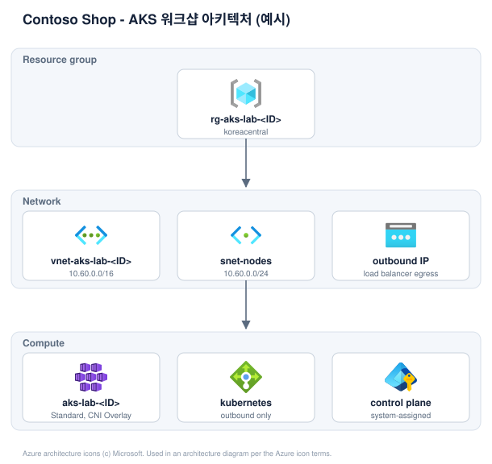

# Lab 08: 문서화 + 정리

**Lab 8 / 8** · 2부 · 실행과 마무리 · ⏱ 50분

🎯 관측된 실제 상태로 인계 문서 만들기 / 승인된 절차로 정리하기

🧠 `azure-resource-lookup` · `azure-resource-visualizer`

> 🎬 화면까지 띄웠으니 끝일까요? 팀장의 두 번째 조건 - **다음 사람이 나 없이도 운영할 수 있을 때** 미션이 완료됩니다.

## 왜 필요한가요?

Azure Resource Manager 그림만으로는 Kubernetes 내부의 Pod/Service 관계를 알 수 없습니다. 두 계층을 나누어 문서화하고, 마지막에는 무엇이 남았는지 확인한 뒤 인계합니다.

## 시작 전에

- [Lab 06](06-run-sample-workload.md)의 결과가 있나요? ([Lab 07](07-diagnose-and-recover.md)은 선택)

## Step 1. 실제 상태 문서화하기

> 🧠 **Skill** `azure-resource-lookup`, `azure-resource-visualizer` &nbsp;·&nbsp; 📋 **아래 프롬프트를 복사해 실행**

```text
azure-resource-lookup과 azure-resource-visualizer Skill을 사용해 저장소 루트의 .env에서 RESOURCE_GROUP과 NODE_RESOURCE_GROUP을 읽고, 그 두 그룹의 실제 Azure 리소스와 관계를 조사해 Mermaid 문서를 작성해줘. 저장소 루트의 evidence-log.md도 함께 읽어서 Lab 01부터 쌓인 결정과 관측 기록을 근거로 써줘. Kubernetes Deployment, Pod, Service 관계는 kubectl 증거를 별도 섹션으로 작성해줘. 관측 사실, 설계값, 추정, 미검증 항목을 구분하고, 증거 로그에 근거가 없는 항목은 미검증으로 표시해줘. 리소스를 변경하지 마. 이 Skill을 쓸 수 없으면 다른 방법으로 대신하지 말고 먼저 알려줘.
```

**확인할 것:** cluster resource group과 node resource group을 모두 조사했는지, Kubernetes 증거(Pod/Service/EndpointSlice)를 Azure ARM 그림과 별도 섹션으로 나눴는지.

### Azure 공식 아이콘으로 그림 만들기

Mermaid는 관계를 보여주지만 아이콘이 없습니다. 같은 조회 결과로 **Azure 공식 아이콘이 들어간 SVG**를 함께 만듭니다.

> 📋 **아래 프롬프트를 복사해 실행**

```text
방금 조회한 실제 리소스로 assets/azure-icons/README.md의 스펙 형식에 맞는 JSON을 만들어줘.
레이어는 Resource group, Network, Compute로 나누고 label에는 실제 리소스 이름을, sub에는 실제 SKU나 CIDR을 넣어줘.
추측한 값은 넣지 말고 조회로 확인한 것만 써줘. 그런 다음 아래를 실행해줘.

bash scripts/build-architecture-svg.sh <만든 스펙>.json img/my-architecture.svg
```



위는 [예시 스펙](../../assets/azure-icons/example-architecture.json)으로 만든 결과입니다. 아이콘은 SVG 안에 인라인되므로 파일 하나만 인계 문서에 넣으면 됩니다.

아이콘은 Microsoft가 배포하는 공식 Azure architecture icons입니다. 아키텍처 다이어그램과 교육 자료 용도로만 쓸 수 있고, 자르거나 회전하거나 변형하면 안 됩니다. 자세한 조건은 [assets/azure-icons/README.md](../../assets/azure-icons/README.md)에 있습니다.

[인계 양식](../../templates/handoff-template.md)에 관측/설계/추정/미검증을 구분해서 채웁니다. Lab 01부터 쌓인 `evidence-log.md`가 그 근거입니다.

<details>
<summary>💡 <b>Skill을 안 썼다면?</b></summary>

| 방식 | 이 단계에서 벌어지는 일 |
| --- | --- |
| 🖐 수동 | 리소스 관계를 눈으로 훑어 손으로 그린다. 빠뜨리기 쉽다. |
| 💬 일반 프롬프트 | 실제 배포와 다른 **일반적인 AKS 아키텍처 그림**을 그려준다. 내 클러스터의 진짜 모습이 아니다. |
| ⚡ Skill | 실제 리소스 그래프를 조회해 **배포된 그대로** 다이어그램을 만든다. |

</details>

## Step 2. 제출하고 정리하기

> 🧠 **Skill** `azure-resource-lookup` &nbsp;·&nbsp; 📋 **아래 프롬프트를 복사해 실행**

```text
azure-resource-lookup Skill을 사용해 저장소 루트의 .env에서 RESOURCE_GROUP과 NODE_RESOURCE_GROUP을 읽고, 그 두 그룹의 현재 리소스를 읽기 전용으로 확인해줘. 삭제 전에 대상과 의존 자원을 표로 보여주고, 실제 삭제 작업은 명시적 승인 전에는 수행하지 마. 이 Skill을 쓸 수 없으면 다른 방법으로 대신하지 말고 먼저 알려줘.
```

삭제를 승인한 뒤 실제로 삭제하고, 다시 조회해서 잔여 자원이 없는지(또는 남은 것이 무엇인지) 확인합니다.

> [!WARNING]
> 삭제하지 않기로 했다면, 그것도 정상입니다. 다만 잔여 자원과 비용 책임자를 인계 문서에 반드시 남기세요.

## ✅ 완료 체크리스트

- [ ] Azure와 Kubernetes 증거가 분리되어 문서화됨
- [ ] 삭제 승인/실행/재조회가 모두 기록됨(또는 미삭제 사유가 기록됨)
- [ ] 인계 문서와 증거 로그가 모두 채워짐
- [ ] **리소스가 실제로 삭제됐는지 다시 조회해 확인함** (비용이 계속 나가지 않도록)

## 🚧 문제가 생겼다면

| 증상 | 원인일 가능성 | 해야 할 일 |
| --- | --- | --- |
| ARM 그림에 Pod/Service가 안 보임 | 정상입니다 | Kubernetes API 조회로 별도 확인 |
| 삭제 후에도 리소스가 남아있음 | 종속 리소스 또는 삭제 지연 | 몇 분 후 재조회. node resource group(`MC_...`)이 함께 지워졌는지도 확인 |
| resource group 삭제가 거부됨 | 리소스 잠금 또는 권한 부족 | 잠금 여부를 확인하고, 내 권한 범위 안에서 개별 리소스부터 삭제 |

## 워크샵을 마칩니다 🎉

수고하셨습니다. Codespace를 더 쓰지 않는다면 GitHub의 Codespaces 목록에서 중지하거나 삭제하세요. Azure 리소스와 달리 Codespace는 사용 시간 기준으로만 과금됩니다.
